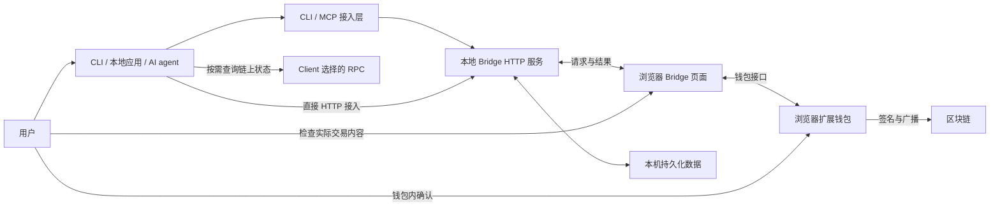

# 架构概览

状态：全局职责与约束基线，2026-11-23 核对本机服务与连接执行边界。实现进度见[当前迭代](iterations/current.md)。

已确认 Go 用于 CLI／HTTP／MCP，React + TypeScript + Vite 用于浏览器页面；单 Go module 与独立前端工程，职责见[模块设计](iterations/00-foundation/design.md#3-模块职责)。目录与接口文档生成方式已确认；依赖版本与构建兼容性随工程初始化验证。

## 1. 概念组件

图示表达运行组件；同一可执行程序通过子命令运行 CLI、HTTP 服务或 STDIO MCP Server，后者采用官方 Go SDK。连接执行与中断恢复见[迭代 2 设计](iterations/02-connection-session/design.md)。钱包凭据保留在钱包内，图中持久化数据不包含私钥或助记词。

| 组件 | 职责 | 待定事项 |
|---|---|---|
| CLI／启动入口 | 确保服务就绪、调用接口、打开或输出链接、等待或查询结果 | 命令、机器可读输出与阻塞方式 |
| 本地 HTTP 服务 | 请求与 Session 管理、钱包操作协调、权限与结果、版本信息 | 交易审批与回传接口 |
| 浏览器页面 | 展示来源及实际交易、取得用户同意、核对钱包状态、调用钱包并回传结果 | 连接页的钱包兼容性与恢复交互 |
| 浏览器钱包 | 管理私钥、账户授权、签名和广播 | 钱包版本与实际兼容性 |
| 本机存储 | SQLite 保存 Session、请求、活动记录、结果与恢复所需信息 | 交易活动记录与用户清理流程 |
| MCP Server | 官方 Go SDK、STDIO；复用 HTTP client，提供 agent 工具交互 | Tool 范围、输出及 Codex 配置 |

UI 链上跟踪留待后续，再补充 RPC 来源与确认语义。

## 2. 已知流程与约束

连接流程：client 指定目标 chainId → 创建连接请求 → 用户打开原请求页面 → 选择钱包和账户、核对网络并同意连接 → 返回固定绑定账户和网络的 Session。

交易流程：client 构造并提交原始交易 → 核对 Session 和参数并冻结内容 → [页面审阅与钱包状态修复](approval-flow.md) → 用户发起钱包确认，调用前再次核对 → 钱包确认并发送 → 回传结果并保存 → client 查询结果及按需跟踪链上状态。

失败与恢复原则：未交给钱包的请求按已确认规则取消或超时；已交给钱包但没有可靠结果时不能声称未发送，保留结果未确定记录并接收迟到结果。重启、重开页面、查询和重试不自动重发。

上述箭头并非状态枚举。取消／过期与交给钱包的竞争边界、写入时序及页面执行归属必须在单笔交易实现前设计并验证，不承诺跨进程“恰好执行一次”。

## 3. 信任边界与设计检查项

- 同一系统用户主动运行的本地 client 视为可信，共用一份服务凭据和管理能力；请求／Session 仅用 UUID 定位，不隔离各 client。名称仍是自报信息，不证明应用身份；浏览器管理授权与用户同意独立保留，见[当前访问模型](iterations/02-connection-session/design.md#pr-2-3a2a单一本机服务凭据)。
- 固定 loopback 地址不能代替访问控制。设计须考虑普通网页跨站请求、Host／Origin 校验，以及页面可使用的凭据范围。
- 浏览器页面与本地服务之间可能断开。应防止多个页面领取同一操作，且不让回传重试重复触发钱包。
- 账户和网络可能在任何时候变化。Session 绑定保持不变，钱包调用前核对并携带明确参数；钱包可变字段及能核验的范围在迭代 3 明确。
- Client 的说明和网络显示名称均不能替代原始参数；界面分别标示来源与事实。chainId 是网络匹配依据。
- 本机记录可能包含账户、交易内容和访问凭据。访问控制、日志脱敏及持久化凭据处理在对应存储设计中明确。
- 私钥、助记词、真实凭据及带访问能力的完整链接不得写入仓库、测试快照或诊断日志；钱包批准由用户完成。

连接执行归属与授权后端已落地，真实钱包兼容性按[当前迭代](iterations/current.md)验收。

浏览器管理授权的有效期与重启行为见[需求 §2](requirements.md#2-面向的-client-与交付方式)；本机令牌的用途和自动管理方式见[凭据说明](local-credentials.md)，一次性授权及服务就绪的历史方案见[迭代 1 设计](iterations/01-local-service/design.md)。

## 4. 设计维护

本文件维护当前全局架构，具体设计按[迭代工作流](iterations/README.md)保存在当轮 design doc。影响全局的已采用方案同步到此；稳定的跨迭代协议按需独立维护并引用。

[迭代 0 设计](iterations/00-foundation/design.md)记录模块、目录与技术栈；HTTP 层采用 `internal/api/`，接口文档生成方式见[接口文档设计](iterations/00-foundation/design.md#接口文档)，存储取舍见[持久化方案](iterations/00-foundation/design.md#6-持久化方案)。活动方案按当前迭代入口查阅；历史设计中的待定项以新一轮结论补充。设计确认不代表功能或构建已验证。
